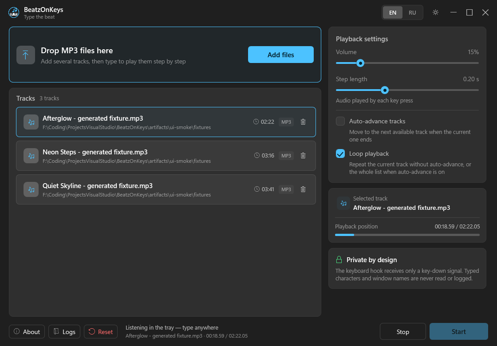
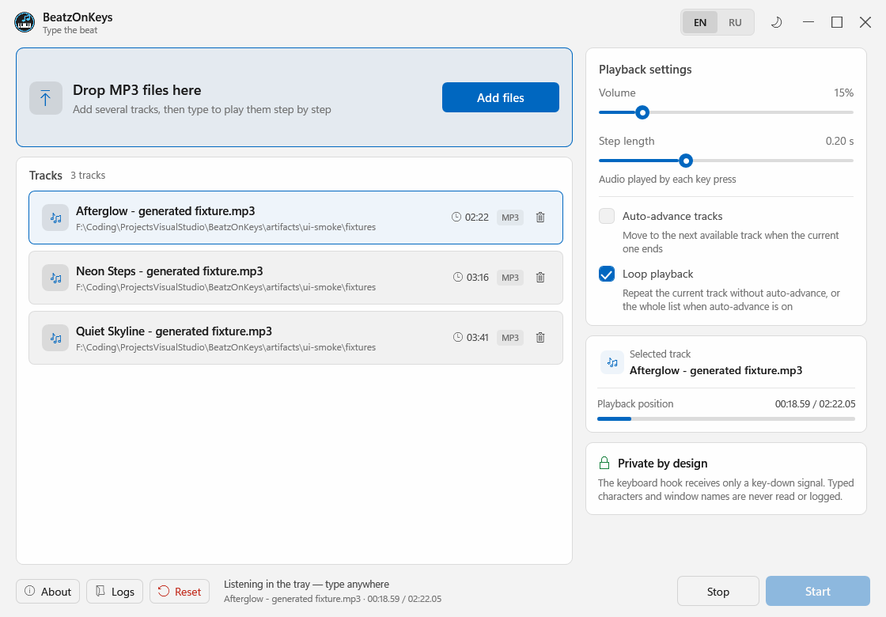

# BeatzOnKeys

[](https://github.com/MusicCat-61/BeatzOnKeys/releases)
[](https://github.com/MusicCat-61/BeatzOnKeys/releases/latest)
[](https://github.com/MusicCat-61/BeatzOnKeys/actions/workflows/ci.yml)
[](LICENSE)
[](https://github.com/MusicCat-61/BeatzOnKeys/releases)
[](#requirements)
[](https://dotnet.microsoft.com/download/dotnet/10.0)



*English interface · the Russian one is shown on the [Russian page](README.ru.md).*

**English** · [Русский](README.ru.md)

**An audio player that advances through a track with each key press. Type — the song plays. Stop typing — the song waits.**

BeatzOnKeys turns everyday typing into hands-on audio scrubbing. Add an MP3 track (WAV is also supported), press **Start**, and every non-modifier key moves the playback cursor by the selected step and plays a short slice of the original recording. Fast typing makes neighboring slices sound almost continuous; a pause leaves the cursor where it is for the next key press.

The app is written in C# with .NET 10 and WPF. Direct audio decoding and playback use the focused NAudio components for Windows output. The portable release is self-contained: extract it and run it without an installer, administrator rights, or a separately installed .NET runtime.

## What is inside

| | |
|---|---|
| 🎹 **Type to scrub** | Every key-down except bare modifiers advances the cursor and plays the next short audio slice |
| 🎧 **Original sound** | Slices come directly from the selected MP3; WAV is available as an additional format |
| ⏱ **Adjustable step** | Choose `0.05`–`0.50` seconds; the default is `0.15` seconds |
| ⚡ **Responsive playback** | Rapid typing produces an almost continuous run through the track; pauses preserve the in-session cursor |
| 🔁 **Advance and loop** | Continue to the next track, repeat one track, or loop the complete list |
| 🪟 **Mica window** | Native Windows 11 backdrop, custom frameless title bar, and a solid Windows 10 fallback |
| 🌗 **Frost themes** | Dark and light MusicCatRGB-inspired palettes switch without a restart |
| 🌐 **Two languages** | English and Russian switch instantly; first launch follows the system language |
| 🔕 **Quiet tray mode** | Start hides the main window while you type in any application |
| 💾 **Session settings** | Tracks, selection, volume, step, language, theme, auto-advance, and loop are restored |
| 🗒 **Plain-text logs** | Daily UTF-8 diagnostics are stored under `%LOCALAPPDATA%\BeatzOnKeys\logs` |
| ⬆️ **Verified updates** | Quiet GitHub checks, SHA-256 verification, safe staging, and portable-folder restart |
| ♻️ **Portable** | Self-contained .NET 10 `win-x64` folder; no installer or elevated privileges |

## How it works

1. **Import** — drag one or more `.mp3` files onto the drop area, or use **Add files**. PCM `.wav` files are supported too.
2. **Select** — choose the track whose timeline you want to scrub.
3. **Set the step** — select `0.05`–`0.50` seconds. New settings start at `0.15` seconds.
4. **Start** — BeatzOnKeys installs a low-level Windows keyboard hook and moves to the system tray.
5. **Type** — every non-modifier key sends a tiny signal to the playback worker. The cursor advances by one step and a short slice is played at the new position.
6. **Pause naturally** — simply stop typing. Playback becomes quiet, while the current cursor remains ready for the next press during this run.
7. **Finish the track** — the Auto-advance and Loop switches determine what happens at the end.

The hook does not perform audio work. Decoding, seeking, short-fragment timing, and output-device calls stay on the playback side, keeping Windows input responsive.

## End-of-track behavior

| Auto-advance | Loop | Result at the end |
|---|---|---|
| Off | Off | Stay at the end; enable Loop, change tracks, or use Stop → Start to restart |
| Off | On | Restart and repeat the same track |
| On | Off | Select the next track; stay at the end after the final track |
| On | On | Select the next track and wrap the complete list back to the first track |

Changing the selected track starts that track from its beginning. Stop → Start preserves a mid-track cursor, but restarts an already finished track. A final short slice may finish after your last key; no further track progress happens during silence.

## Privacy

The keyboard hook follows the privacy-preserving approach used by MusicCatRGB:

- it does **not** convert key codes into text;
- it does **not** inspect the focused window, clipboard, or text fields;
- it does **not** log keys or application names;
- injected key events and bare modifier presses are ignored;
- the callback only queues a small playback signal and returns immediately.

The hook is active only after **Start** and is removed on **Stop** or exit.

## Installation

### Portable release

1. Download the latest **BeatzOnKeys win-x64** archive from [Releases](https://github.com/MusicCat-61/BeatzOnKeys/releases/latest).
2. Extract the **whole archive** to a writable location, for example `C:\BeatzOnKeys`.
3. Keep the published files together; do not move only `BeatzOnKeys.exe`.
4. Run `BeatzOnKeys.exe`.

No installer, administrator rights, or separate .NET runtime are required.

**Upgrading from 1.0.0:** close the old app, download 1.0.1 manually, and extract it into a new folder. The new app automatically keeps your existing playlist, selected track, volume, language, and theme. Use the archive rather than the old version's built-in installer for this migration.

### Requirements

- Windows 10 x64 or Windows 11 x64.
- A working Windows audio output device.
- At least one readable MP3 file; PCM WAV is optional.

## Usage

1. Add one or more MP3 files, or WAV files when needed.
2. Select a track.
3. Adjust **Volume** and **Step**. Step accepts `0.05`–`0.50` seconds and defaults to `0.15`.
4. Choose the desired Auto-advance and Loop combination from the table above.
5. Click **Start**. The window hides into the tray.
6. Type in any application. Every non-modifier press advances the cursor and plays a short slice.
7. Pause typing whenever you want; the in-session cursor remains in place.
8. Double-click the tray icon to reopen the window, or use **Stop playback** / **Exit** in its menu.

**Reset** removes imported entries and saved settings. It never deletes the original audio files.

## Languages and themes

Both switches are available in the title bar:



[Updated About dialog](assets/about-ru.png) · [Light About dialog](assets/about-light-ru.png)

- `EN | RU` changes the interface language immediately;
- the sun/moon button swaps the complete light/dark palette immediately;
- both choices are saved in `%LOCALAPPDATA%\BeatzOnKeys\settings.json`.

This repository contains matching documentation in [English](README.md) and [Russian](README.ru.md).

## Settings and app data

BeatzOnKeys keeps per-user data under `%LOCALAPPDATA%\BeatzOnKeys`:

```text
BeatzOnKeys/
├─ settings.json          # Volume, StepSeconds, AutoAdvance, Loop,
│                         # SelectedTrackId, Language, Theme, Tracks
├─ logs/                  # daily UTF-8 log files, retained by the app
└─ updates/               # verified update staging data
```

`Volume` is normalized to `0.0`–`1.0`. `StepSeconds` is normalized to `0.05`–`0.50` and defaults to `0.15`.

The current fragment position is runtime playback state, not part of the persisted-settings contract. Tracks and the selected track are restored, but documentation does not promise that an exact cursor position survives an application restart.

## About and updates

**About** is available from the footer and tray menu. It shows the installed version, developer, project/license/support links, and update controls. MusicCatRGB attribution remains in [Credits & License](#credits--license) and the third-party notices.

Update checks stay quiet:

- a background check runs after startup;
- only a genuinely newer release produces a tray notice;
- opening **About** can refresh a stale result;
- **Check for updates** remains available manually.

A downloaded release is verified against its published SHA-256 checksum before staging. Archive paths are validated before extraction. **Install and restart** uses a detached helper to replace the writable portable folder and launch BeatzOnKeys again. Per-user settings and logs are outside that folder and are not overwritten.

## Logs

Logs are written to `%LOCALAPPDATA%\BeatzOnKeys\logs\beatzonkeys-YYYYMMDD.log`. Use **Logs** in the footer to open the folder.

| Category | What it records |
|---|---|
| `[audio]` | Decoder, seek, output-device, and short-fragment failures |
| `[playback]` | Global playback lifecycle and worker failures — never typed keys |
| `[settings]` | Settings load, normalization, and save failures |
| `[update]` | Automatic/manual checks, verification, staging, and apply results |
| `[ui]` | User-interface lifecycle and unhandled UI errors |

Example:

```text
2026-11-04 12:30:15.207 +03:00 [INF] [audio] Opened track 'example.mp3'.
2026-11-04 12:30:18.044 +03:00 [INF] [playback] Global keyboard playback started.
```

## Building from source

Requires Windows and the .NET 10 SDK:

```powershell
dotnet build BeatzOnKeys.sln -c Release
```

The non-interactive test harness can be run with:

```powershell
dotnet run --project BeatzOnKeys.Tests -c Release
```

Create the portable self-contained folder with:

```bat
publish.bat
```

The publisher:

1. verifies that its cleanup target is exactly the repository's `Build_Output` folder;
2. publishes `BeatzOnKeys.UI` self-contained for `win-x64` with version `1.0.1` by default;
3. copies both READMEs, release notes, screenshots, the project license, and third-party notices;
4. stops immediately if publishing or any required copy fails.

The resulting `Build_Output` directory is the portable product.

### Repository layout

```text
BeatzOnKeys.Core/       playback, settings, keyboard hook, updates
BeatzOnKeys.UI/         WPF shell, Frost themes, EN/RU resources, tray lifecycle
BeatzOnKeys.Tests/      non-interactive console test harness
assets/                 English and Russian screenshots
third-party/            licenses for redistributed/adapted components
publish.bat             one-command self-contained publisher
```

## Troubleshooting

- **No sound while typing** — select a readable track, confirm that Windows has an output device, and raise Volume.
- **A track will not open** — confirm that the file still exists and try a normal MP3 or PCM WAV file.
- **Playback sounds too sparse** — reduce Step toward `0.05`; for a calmer effect, increase it toward `0.50`.
- **The track stays at its end** — select it again, enable Loop, or enable Auto-advance when more tracks exist.
- **An update will not install** — keep the complete app in a writable folder and inspect `%LOCALAPPDATA%\BeatzOnKeys\logs\update-apply.log`.
- **The window disappeared** — this is expected after Start; double-click the BeatzOnKeys tray icon.
- **A restored source is gone** — add the file again or remove the unavailable entry from the track list.

## Credits & License

- **BeatzOnKeys:** [https://github.com/MusicCat-61/BeatzOnKeys](https://github.com/MusicCat-61/BeatzOnKeys)
- Design, themes, localization structure, Mica shell, tray lifecycle, and keyboard-hook approach are based on [**MusicCatRGB**](https://github.com/MusicCat-61/MusicCatRGB) by MusicCat161 / MusicCat-61.
- Audio decoding and Windows output use [**NAudio**](https://github.com/naudio/NAudio).

BeatzOnKeys is distributed under the [MIT License](LICENSE). Required MusicCatRGB and NAudio notices are retained in [THIRD-PARTY-NOTICES.md](THIRD-PARTY-NOTICES.md).
