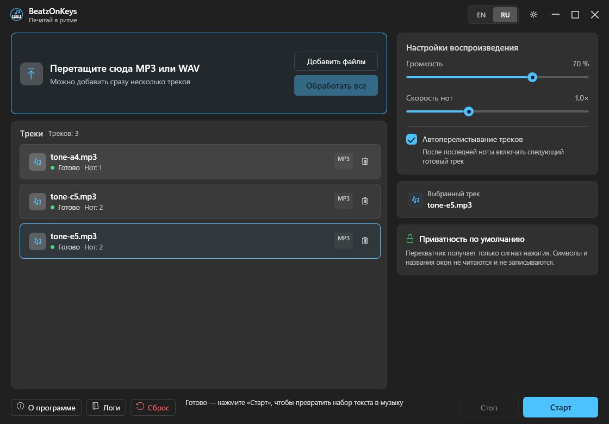

# BeatzOnKeys

[](https://github.com/MusicCat-61/BeatzOnKeys/releases)
[](https://github.com/MusicCat-61/BeatzOnKeys/releases/latest)
[](https://github.com/MusicCat-61/BeatzOnKeys/actions/workflows/ci.yml)
[](LICENSE)
[](https://github.com/MusicCat-61/BeatzOnKeys/releases)
[](#требования)
[](https://dotnet.microsoft.com/download/dotnet/10.0)



*Русский интерфейс; английский показан на [английской странице](README.md).*

[English](README.md) · **Русский**

BeatzOnKeys превращает обычный набор текста в мелодию. Импортируйте один или несколько треков MP3/WAV, транскрибируйте их в MIDI с помощью Spotify Basic Pitch, нажмите **«Старт»** — и каждое нажатие клавиши будет воспроизводить следующую найденную ноту. Пока вы печатаете в любом приложении, главное окно не мешает и остаётся в системном трее.

Программа написана на C# (.NET 10 + WPF). Встроенный полифонический синтезатор работает через NAudio, результаты транскрипции читает Melanchall.DryWetMidi. Python, Basic Pitch, модель ONNX и все Python-зависимости уже лежат в папке релиза: пользователю не нужно ничего устанавливать и не требуются права администратора.

> [!NOTE]
> Basic Pitch понимает разные инструменты и полифонию, но точнее всего работает с чистой записью одного инструмента. В плотном мастер-миксе нот может быть меньше, а распознавание — менее точным.

## Что внутри

| | |
|---|---|
| 🎹 **Набор текста как игра** | Каждое нажатие, кроме одиночных Shift, Ctrl, Alt и других модификаторов, запускает следующую ноту |
| 🎼 **Аудио в MIDI** | Транскрипция MP3/WAV встроенным Basic Pitch через ONNX Runtime |
| 📚 **Пакетная очередь** | Можно перетащить несколько файлов, обработать всё по очереди и видеть статус каждого трека |
| 🔁 **Автоперелистывание** | После последней ноты автоматически выбирается следующий готовый трек |
| 🔊 **Встроенный синтезатор** | Синусоидально-гармонический синтезатор NAudio — MIDI-устройство и SoundFont не нужны |
| 🪟 **Окно Mica** | Нативная подложка Windows 11, собственный заголовок без системной рамки, fallback для Windows 10 |
| 🌗 **Темы Frost** | Светлая и тёмная палитры в стиле MusicCatRGB, меняются без перезапуска |
| 🌐 **Два языка** | Русский и английский переключаются сразу; при первом запуске выбирается язык системы |
| 🔕 **Тихий режим в трее** | После старта окно скрывается; нет визуализатора клавиатуры, RGB-подсветки и лишних уведомлений |
| 💾 **Восстановление сессии** | Сохраняются треки, готовый MIDI-кэш, выбор, громкость, скорость, язык, тема и автопереход |
| 🗒 **Обычные текстовые логи** | Ежедневная UTF-8 диагностика в `%LOCALAPPDATA%\BeatzOnKeys\logs` |
| ⬆️ **Проверенные обновления** | Тихая проверка GitHub, загрузка из «О программе», SHA-256 и перезапуск портативной папки |
| ℹ️ **О программе** | Версия, авторы, ссылки, лицензии, поддержка и управление обновлениями |
| ♻️ **Портативность** | Самодостаточный `.NET 10`-набор и папка `python` рядом; без установщика и прав администратора |

## Как это работает

1. **Импорт** — перетащите `.mp3` или `.wav` в область загрузки либо нажмите **«Добавить файлы»**.
2. **Транскрипция** — **«Обработать все»** запускает встроенный `python\python.exe` отдельно для каждого ожидающего трека. `Tools\transcribe.py` загружает ONNX-модель Basic Pitch и пишет MIDI в пользовательский кэш.
3. **Разбор** — DryWetMidi сортирует ноты и преобразует их время и velocity в последовательность в памяти.
4. **Старт** — BeatzOnKeys устанавливает низкоуровневый перехватчик клавиатуры и скрывает окно в трей.
5. **Воспроизведение** — перехватчик передаёт рабочему потоку только сигнал «нажата не-модифицирующая клавиша». Следующая нота синтезируется через NAudio; громкость и длительность зависят от ползунков.
6. **Переход** — при включённом автоперелистывании последняя нота выбирает следующий готовый трек и ставит его курсор в начало.

Одновременные MIDI-ноты намеренно превращаются в детерминированную последовательность: одно физическое нажатие всегда означает одну следующую ноту.

## Приватность

Перехватчик клавиатуры адаптирован из приватного подхода MusicCatRGB:

- он **не** преобразует коды клавиш в символы;
- он **не** читает активное окно, буфер обмена и текстовые поля;
- он **не** записывает клавиши и названия приложений в лог;
- программно внедрённые события и одиночные модификаторы игнорируются;
- callback только ставит короткий сигнал в очередь, поэтому обработка звука не блокирует ввод Windows.

Перехват работает только после **«Старт»** и снимается по **«Стоп»** или при выходе.

## Установка

### Портативный релиз

1. Скачайте последний архив **BeatzOnKeys win-x64** на странице [Releases](https://github.com/MusicCat-61/BeatzOnKeys/releases/latest).
2. Распакуйте **всю папку** в доступное для записи место, например `C:\BeatzOnKeys`.
3. Держите `BeatzOnKeys.exe`, `Tools` и `python` вместе. Нельзя переносить только EXE.
4. Запустите `BeatzOnKeys.exe`. Установщик, отдельные .NET Runtime и Python, а также права администратора не нужны.

Первая транскрипция может запускаться дольше из-за загрузки нейросетевой модели. Обработка нагружает CPU, но интерфейс остаётся отзывчивым, а у каждого трека есть собственный статус.

### Требования

- Windows 10 x64 или Windows 11 x64.
- Рабочее устройство вывода звука по умолчанию.
- Достаточно места для портативного Python и MIDI-кэша.

## Использование

1. Добавьте один или несколько MP3/WAV. Три файла можно перетащить одной операцией.
2. Нажмите **«Обработать все»**. Статус проходит **«Ожидает → Обработка… → Готово»** (либо **«Ошибка»** с локализованной подсказкой).
3. Выберите любой готовый трек.
4. Настройте **громкость** и **скорость нот**.
5. При необходимости включите **«Автоперелистывание треков»**.
6. Нажмите **«Старт»** — окно исчезнет в трей.
7. Печатайте в любом приложении. Каждое нажатие не-модификатора воспроизводит следующую ноту.
8. Дважды щёлкните значок в трее, чтобы вернуть окно, либо выберите **«Остановить воспроизведение»** / **«Выход»** в меню значка.

**«Сброс»** удаляет записи треков, кэш MIDI и настройки. Исходные MP3/WAV никогда не удаляются.

## Язык и тема

Оба переключателя находятся в собственном заголовке окна:

- `EN | RU` мгновенно меняет все динамические строки интерфейса и сообщения об ошибках;
- кнопка солнца/луны сразу заменяет всю светлую/тёмную палитру;
- оба выбора сохраняются в `%LOCALAPPDATA%\BeatzOnKeys\settings.json` и восстанавливаются при запуске.

В репозитории есть совпадающая документация на [английском](README.md) и [русском](README.ru.md).

## Сохранение и кэш

Пользовательское состояние и созданные файлы хранятся только в `%LOCALAPPDATA%\BeatzOnKeys`:

```text
BeatzOnKeys/
├─ settings.json          # громкость, скорость, выбранный трек, тема, язык, очередь
├─ midi/                  # готовые MIDI от Basic Pitch
└─ logs/                  # ежедневные UTF-8 логи, хранятся 14 дней
```

Готовый трек восстанавливается из кэшированного MIDI без повторного запуска Basic Pitch. Если кэш или исходник пропал, программа показывает понятную локализованную ошибку, а не запускает скрытую повторную обработку.

## О программе и обновления

Окно **«О программе»** открывается из нижней панели и меню трея. В нём видны установленная версия, ссылки на проект, MusicCatRGB, лицензии и поддержку, а также весь процесс обновления.

Автопроверка работает тихо, как в MusicCatRGB:

- первая проверка начинается через несколько секунд после запуска;
- таймер трея просыпается раз в 15 минут, но успешный ответ используется 30 минут;
- после сетевой ошибки повтор идёт через 5 минут, без диалога при старте;
- уведомление в трее появляется только при действительно новой версии; клик открывает «О программе»;
- при открытии «О программе» устаревший результат обновляется, а ручная кнопка доступна всегда.

Скачанный файл не считается доверенным автоматически. BeatzOnKeys получает `BeatzOnKeys-win-x64.zip` вместе с `.sha256`, проверяет SHA-256, безопасно распаковывает без выхода за целевую папку и убеждается, что внутри есть EXE, `python\python.exe` и скрипт транскрипции. Кнопка **«Установить и перезапустить»** запускает отдельный PowerShell-помощник, закрывает приложение, копирует проверенную портативную сборку поверх текущей папки, пишет результат в лог и запускает BeatzOnKeys снова. Настройки и MIDI-кэш в `%LOCALAPPDATA%` не заменяются.

Папка приложения должна быть доступна для записи; права администратора не запрашиваются. При неудаче старый EXE сохраняется, а результат показывается при следующем запуске.

## Логи

Логи лежат в `%LOCALAPPDATA%\BeatzOnKeys\logs\beatzonkeys-YYYYMMDD.log`. Кнопка **«Логи»** в нижней панели открывает эту папку.

| Категория | Что записывается |
|---|---|
| `[settings]` | Ошибки чтения/записи настроек и некорректные восстановленные записи |
| `[transcription]` | Результат Python-процесса, путь MIDI и сбои Basic Pitch |
| `[midi]` | Некорректные или нечитаемые файлы MIDI из кэша |
| `[playback]` | Старт/стоп глобального воспроизведения и сбои рабочего потока — но не клавиши |
| `[cache]` | Ошибка удаления принадлежащего приложению MIDI-кэша |
| `[update]` | Автоматические/ручные проверки, проверка архива, отдельная установка и её результат |
| `[startup]`, `[shutdown]`, `[ui]` | Жизненный цикл и необработанные ошибки интерфейса |

Пример:

```text
2026-11-04 12:30:15.207 +03:00 [INF] [transcription] Created MIDI for 'piano.wav' at '...\midi\....mid'.
2026-11-04 12:30:18.044 +03:00 [INF] [playback] Global keyboard playback started.
```

## Сборка из исходников

Нужны Windows и .NET 10 SDK. Для обычной сборки разработчика Python не требуется:

```powershell
dotnet build BeatzOnKeys.sln -c Release
```

Обязательный скрипт публикации создаёт полный набор для пользователя:

```bat
publish.bat
```

`publish.bat`:

1. публикует `BeatzOnKeys.UI` self-contained под `win-x64`;
2. скачивает официальный встраиваемый CPython 3.10.11 и проверяет SHA-256;
3. ставит зафиксированные Basic Pitch 0.4.0 и ONNX-зависимости в `Build_Output\python`;
4. проверяет импорты и наличие модели;
5. копирует оба README и лицензионные уведомления.

Итоговая папка `Build_Output` — готовый портативный продукт. Для работы publish-скрипта нужен интернет; готовому приложению сеть для транскрипции не требуется.

### Структура репозитория

```text
BeatzOnKeys.Core/       модели, настройки, процесс Basic Pitch, MIDI, hook, синтезатор
BeatzOnKeys.UI/         оболочка WPF, темы Frost, EN/RU, жизненный цикл трея
build/                  сборщик портативного Python и закреплённые зависимости
assets/                 скриншоты английского и русского интерфейса
publish.bat             единая self-contained публикация
```

## Если что-то не работает

- **Не найден встроенный Python** — восстановите полную папку релиза: `python\python.exe` должен лежать рядом с приложением.
- **Basic Pitch падает на MP3** — попробуйте PCM WAV, чтобы отделить проблему кодека; подробности есть в подсказке трека и логе.
- **Ноты не найдены** — возьмите более чистый инструментальный фрагмент или более громкий исходник без лишнего шума/перкуссии.
- **При печати нет звука** — выберите готовый трек, проверьте устройство вывода Windows и увеличьте громкость.
- **Обновление не устанавливается** — держите полную папку приложения в доступном для записи месте; после неудачного перезапуска смотрите `%LOCALAPPDATA%\BeatzOnKeys\logs\update-apply.log`.
- **Окно исчезло** — после старта это нормально; дважды щёлкните значок BeatzOnKeys в трее.
- **Исходник после перезапуска пропал** — готовый MIDI всё ещё воспроизводится; необработанный отсутствующий файл получает статус ошибки.

## Авторы и лицензия

- **BeatzOnKeys:** [https://github.com/MusicCat-61/BeatzOnKeys](https://github.com/MusicCat-61/BeatzOnKeys)
- Дизайн, темы, структура локализации, Mica-оболочка, работа с треем и подход к перехвату клавиатуры основаны на [**MusicCatRGB**](https://github.com/MusicCat-61/MusicCatRGB) от MusicCat161 / MusicCat-61.
- Аудио в MIDI преобразует [**Basic Pitch**](https://github.com/spotify/basic-pitch) от Spotify.
- Звук выводит [**NAudio**](https://github.com/naudio/NAudio), MIDI разбирает [**DryWetMidi**](https://github.com/melanchall/drywetmidi).

BeatzOnKeys распространяется по [лицензии MIT](LICENSE). Обязательные MIT-уведомления MusicCatRGB и атрибуция основных зависимостей сохранены в [THIRD-PARTY-NOTICES.md](THIRD-PARTY-NOTICES.md).
